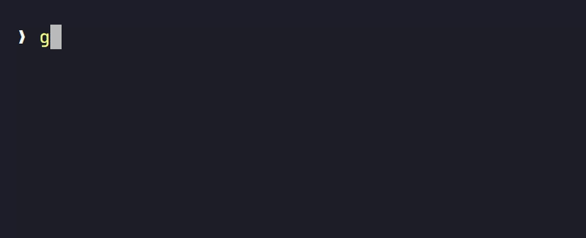
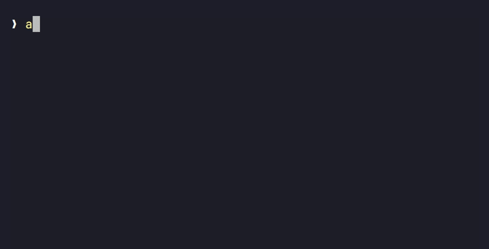

# ai

**Quick questions and shell commands from the command line, through Codex or Claude Code.**

<table>
<tr>
<td width="50%" valign="top">
<p><b>Ask</b></p>

<p><sub>A straight answer, with the command first.</sub></p>
</td>
<td width="50%" valign="top">
<p><b>Run</b></p>

<p><sub><code>y</code> runs it, <code>e</code> edits it, <code>r</code> asks for a different one.</sub></p>
</td>
</tr>
<tr>
<td valign="top">
<p><b>Follow up</b></p>

<p><sub><code>ai -c</code> reads the error you just hit.</sub></p>
</td>
<td valign="top">
<p><b>Configure</b></p>

<p><sub>Provider, model, effort and the rest on one screen.</sub></p>
</td>
</tr>
</table>

- **No API keys.** If `codex` or `claude` runs on your machine, `ai` does too.
- **Fast.** No coding-agent system prompt, no tools, no MCP servers get included in the prompt.
- **No quotes.** Apostrophes, `$` and `?` just work, after a one-time `ai --setup`.
- **Pretty output.** Markdown renders as it streams in.
- **Generate commands.** `-e` writes the command, press `y` to run it or `r` to revise it.
- **Follow-ups from your screen.** `-c` reads the terminal, so there's no chat to manage.
- **Easy configuration** with an interactive menu.

Windows, macOS and Linux. PowerShell, cmd, bash, zsh and fish.

## Examples

**Ask questions**

```sh
ai what's the difference between git merge and git rebase?
```

**Run commands**, then approve, decline or edit them before they run

```sh
ai -e undo my last commit but keep the changes
```

**Include context from the terminal**

```sh
ai -c why did that fail
```

**Pipe in anything**

```sh
git diff | ai write a commit message
```

**Use tools to read files and search the web**

```sh
ai -t which dependencies in go.mod are out of date?
```

**Change settings**

```sh
ai --config
```

**Can't I just use `claude -p` or `codex exec`?**

You can, but a plain `claude -p` starts the whole coding agent: its long system prompt, every tool, your MCP servers, hooks and `CLAUDE.md`. To send only your question, as `ai` does, you need this:

```sh
CLAUDE_CODE_DISABLE_NONESSENTIAL_TRAFFIC=1 claude -p \
  --safe-mode --disable-slash-commands --strict-mcp-config \
  --tools "" --no-session-persistence --model sonnet --effort low \
  --system-prompt "You are a command-line assistant. Answer concisely in Markdown." \
  "what's the difference between git merge and git rebase?"
```

And then you still get raw Markdown, no terminal context, and no safe way to run a command. Codex is worse: `codex exec` loads your Codex setup too, and switching it off takes more than 30 `-c` overrides.

## Install

You need Go 1.27 and either [Codex](https://github.com/openai/codex) or [Claude Code](https://github.com/anthropics/claude-code), installed and logged in.

```sh
go install -ldflags "-s -w" github.com/FallDownTheSystem/ai-cli/cmd/ai@latest
ai --setup    # optional: lets you skip quotes
```

Or skip setup and run `ai` on its own. You get an input line the shell never touches.

---

<details>
<summary><b>Flags</b></summary>

Flags go before the prompt. Everything after them is the prompt, so `ai what does ls -c do` keeps its `-c`. Short flags combine: `ai -ec now only the json files`.

| Flag | What it does |
| --- | --- |
| `-e`, `--execute` | Write a command for your shell, ask before running it |
| `-c`, `--continue` | Send the terminal since the last `ai` question. `-cc` or `-c3` reaches further back |
| `-t`, `--tools` | Let the model read files in this folder and search the web |
| `-p`, `--provider` | `codex` or `claude`, for this run |
| `-m`, `--model` | Model name or alias, for this run |
| `--stream`, `--no-stream` | Show the answer as it's written, or only once it's done |
| `--config [key=value...]` | Open the settings picker, or set keys directly |
| `--setup [shell]`, `--init [shell]` | Add the no-quotes key handler to your shell's startup file |
| `--` | Stop reading flags, for a prompt that starts with a dash |

In `-e`, the keys are `y`/Enter to run, `e` to edit, `r` to ask for a revision, and Esc to cancel. The command runs in a child shell, so `cd` won't move your session and profile aliases aren't loaded.

</details>

<details>
<summary><b>Settings and environment variables</b></summary>

A flag beats the config file, which beats the environment, which beats the default. The file lives at `~/.config/ai/config.toml` (or under `$XDG_CONFIG_HOME`).

```sh
ai --config provider=claude model=opus
ai --config codex.model=sol effort=medium
ai --config model=        # an empty value clears the key
```

| Key | Env variable | Default |
| --- | --- | --- |
| `provider` | `AI_PROVIDER` | `codex` |
| `codex.model`, `claude.model` | `AI_MODEL` | `luna`, `sonnet` |
| `codex.path`, `claude.path` | `AI_CODEX_PATH`, `AI_CLAUDE_PATH` | found on `PATH` |
| `effort` | `AI_EFFORT` | `low` |
| `instructions` | `AI_INSTRUCTIONS` | none; added to every prompt, such as `Answer in Finnish.` |
| `shell` | `AI_SHELL` | the shell that started `ai` |
| `stream` | `AI_STREAM` | `true` |
| `context_commands` | `AI_CONTEXT_COMMANDS` | `5` |
| `context_lines` | `AI_CONTEXT_LINES` | `500` |
| `style` | `GLAMOUR_STYLE` | `dark` (also `light`, `dracula`, `tokyo-night`, `pink`, `ascii`, `notty`, or a JSON file) |

Model aliases: `luna`, `terra`, `sol` and `astra` for Codex (each picks the newest model in that family), `haiku`, `sonnet`, `opus` and `fable` for Claude. Full model names work too.

`ai --config` rewrites the whole file, so hand-written comments don't survive it.

</details>

<details>
<summary><b>What <code>ai --setup</code> changes</b></summary>

Shells read `'`, `$` and `()` before `ai` ever starts, so `ai what's up` leaves the shell waiting for a closing quote. `ai --setup` shows you one line, asks, then adds it to your startup file:

| Shell | File | Line |
| --- | --- | --- |
| PowerShell | `$PROFILE` | `ai --init pwsh \| Out-String \| Invoke-Expression` |
| zsh | `~/.zshrc` | `eval "$(ai --init zsh)"` |
| bash 4.4+ | `~/.bashrc` | `eval "$(ai --init bash)"` |
| fish | `~/.config/fish/config.fish` | `ai --init fish \| source` |

When you press Enter on an `ai` line, the handler quotes the prompt for you (PowerShell gets `--%` instead, and only when the prompt needs it). The quoted line is what you see and what lands in your history.

A few limits: a `|` still pipes, so the prompt can't contain one. Anything after the prompt, like `> out.txt`, becomes part of it, so pipe instead: `ai ... | tee out.txt`, or `| Set-Content out.txt` in PowerShell. Prompts you quoted yourself are left alone.

cmd needs no setup. Quote a prompt there only if it contains `&`, `|`, `<`, `>`, `^` or `%`.

</details>

<details>
<summary><b>Follow-ups with <code>-c</code></b></summary>

`ai -c` sends everything from your last `ai` command to now, its answer included. A chain of `ai -c` follow-ups stays together. With no earlier `ai` on screen, it sends your last 5 commands and their output.

`-cc` reaches two questions back, `-c3` three. (`-c 3` with a space makes the `3` part of the prompt.)

`ai` reads the screen from the first of these that works: Kero, tmux, Zellij, GNU screen, WezTerm, kitty (with `allow_remote_control yes`), or the Windows console. Terminal.app, iTerm2, GNOME Terminal and Alacritty don't let programs read the screen, so run `ai` inside tmux, Zellij or screen there.

</details>

<details>
<summary><b>Tools with <code>-t</code></b></summary>

With `-t`, the model can look around before it answers. Codex runs read-only commands in its sandbox and searches the web. Claude gets `Read`, `Grep`, `Glob`, `WebSearch` and `WebFetch`, with file access limited to the current folder. Each tool call shows as a line above the answer, such as `↳ run Get-Content go.mod`.

Nothing it can call writes files. `WebFetch` can still open any URL, though, so a file that tells the model to send your code somewhere could get it sent. Use `-t` in folders you trust.

</details>

<details>
<summary><b>What the model gets</b></summary>

Both providers get `ai`'s own short system prompt instead of their coding-agent one, save no session, and run from the temp directory unless you pass `-t`.

- **Codex** runs `codex app-server` with an ephemeral thread, a read-only sandbox, and every MCP server, plugin, app, memory and hook in your config turned off for that run.
- **Claude** runs `claude -p` in safe mode with no tools, MCP servers, slash commands, `CLAUDE.md` or transcript, and with nonessential traffic off.

When stdout isn't a terminal, `ai` prints the answer as plain Markdown, with no spinner or colors, so `ai ... | tee answer.md` saves it as is.

</details>
